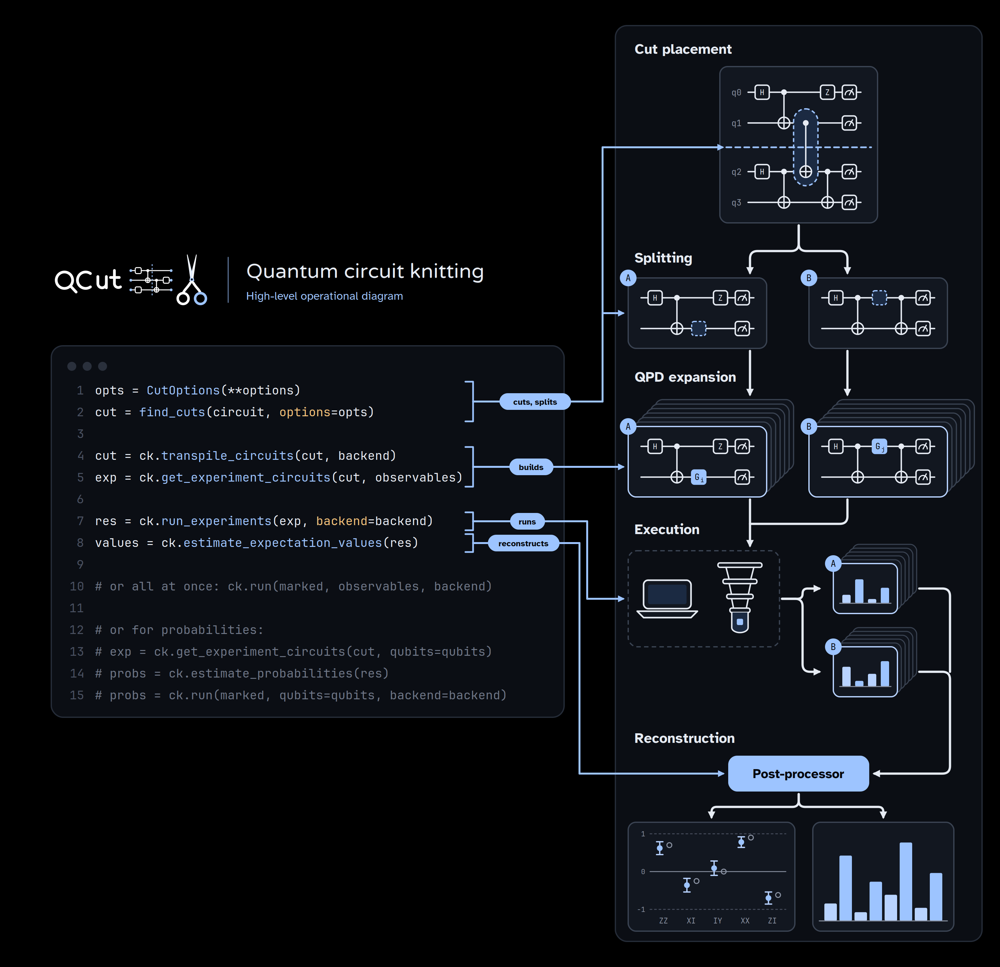

[](https://github.com/JooNiv/QCut/releases)
[](https://coveralls.io/github/JooNiv/QCut?branch=main)

[](https://opensource.org/licenses/Apache-2.0)

# QCut



QCut is a quantum circuit knitting package built on top of qiskit for performing gate cuts and resetless wire cuts allowing simulation of larger quantum circuits on smaller quantum devices or simulators at the cost of a circuit overhead. QCut has been designed and tested to work with IQM's qpus, and the Finnish Quantum Computing Infrastructure ([FiQCI](https://fiqci.fi/)).

QCut has been built at CSC - IT Center for Science (Finnish IT Center for Science).

See the [documentation](https://jooniv.github.io/QCut/) for the full usage guide, every option, examples and the theory behind the decompositions.

# Installation

A UNIX-like system is needed, since [PyMetis](https://github.com/inducer/pymetis) is used for automatic cut finding. On Windows use WSL.

```bash
uv pip install QCut
#or
uv add QCut
```

QCut does not install a simulator. The examples run on [Qiskit Aer](https://github.com/Qiskit/qiskit-aer): `uv pip install qiskit-aer`.

For IQM hardware and fake backends, install the extra, which holds Qiskit below 2.2:

```bash
uv pip install "QCut[iqm]"
```

See [Getting started](https://jooniv.github.io/QCut/GettingStarted.html) for installing from source and other details.

# Quick start

Mark where to cut, split the circuit, build the experiment for the observables wanted,
run it, and put the expectation values back together:

```python
import QCut as ck
from QCut import cut, cutGate
from qiskit import QuantumCircuit
from qiskit.circuit.library import CXGate
from qiskit_aer import AerSimulator

circuit = QuantumCircuit(5)
for qubit in range(5):
    circuit.ry(0.4 + 0.3 * qubit, qubit)
circuit.cx(0, 1)
circuit.append(**cutGate(CXGate(), 1, 2))  # a gate cut
circuit.cx(2, 3)
circuit.append(cut(), [3])  # a wire cut
circuit.cx(3, 4)

observables = ["IIIIZ", "IIZII", "ZZIII"]

cut_circuit = ck.get_locations_and_subcircuits(circuit)
# On a device with a coupling map, transpile the subcircuits for it here:
# cut_circuit = ck.transpile_subcircuits(cut_circuit, backend)
experiment = ck.get_experiment_circuits(cut_circuit, observables)

job = ck.submit_experiments(experiment, backend=AerSimulator(), shots=4096)
print(ck.estimate_expectation_values(job.result()))
```

`[0.9204 0.3866 -0.0315]`, against exact values of `[0.9211 0.3806 -0.0292]`.

`find_cuts()` finds and places cuts automatically instead, and `ck.estimate_run(experiment)` calculates
what running an experiment will cost before submission. The
[usage guide](https://jooniv.github.io/QCut/Usage.html) goes through each step.

## Several circuits at once

`CutEstimator` and `CutQuasiSampler` can run a list of cut circuits in one call, shaped like
[FiQCI-EMS](https://github.com/FiQCI/fiqci-ems)'s estimator and sampler:

```python
from QCut import CutEstimator, CutOptions, find_cuts

ghz = QuantumCircuit(6)
ghz.h(0)
for qubit in range(5):
    ghz.cx(qubit, qubit + 1)
found = find_cuts(ghz, options=CutOptions(finder_num_partitions=2))

estimator = CutEstimator(AerSimulator())
job = estimator.run([cut_circuit, found], [observables, "ZZZZZZ"], shots=4096)
print(job.result().expectation_values())
```

`[array([0.9160, 0.3853, -0.0328]), array(0.9999)]`

`CutQuasiSampler` reconstructs the distribution over the qubits a circuit measured instead.
See [Primitives](https://jooniv.github.io/QCut/Primitives.html).

# Why QCut

Where one of QCut's joint decompositions applies, the same cuts cost less than with IBM's
[qiskit-addon-cutting](https://github.com/Qiskit/qiskit-addon-cutting):

| | QCut | addon |
| --- | --- | --- |
| three wires cut at the same point | γ 15, 240 subexperiments | γ 64, 1024 |
| three rotations crossing one split | γ 7.16, 264 subexperiments | γ 10.5, 432 |
| an `rzz` and an `rxx` on each of three crossing pairs | γ 115 | γ 203 |

Where none applies the two agree exactly. [`benchmarks/QCutVsAddon.ipynb`](./benchmarks/QCutVsAddon.ipynb)
has the comparison, run with `uv sync --group benchmark`.

# Documentation

[jooniv.github.io/QCut](https://jooniv.github.io/QCut/). To build it locally:

```bash
uv sync --group docs
cd docs
uv run sphinx-build -v -b html . build/sphinx/html -W
```

# Acknowledgements

This project is built on top of [Qiskit](https://github.com/Qiskit/qiskit) which is licensed under the Apache 2.0 license.

# License

[Apache 2.0 license](https://github.com/JooNiv/QCut/blob/main/LICENSE)
